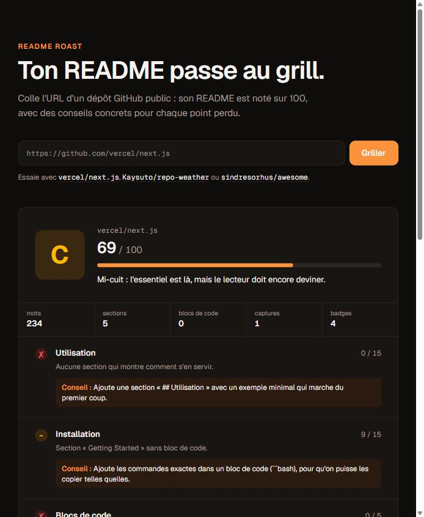

# README Roast

[](https://github.com/Kaysuto/readme-roast/actions/workflows/ci.yml)
[](LICENSE)

Colle l'URL d'un dépôt GitHub public : README Roast note son README sur 100 et donne un conseil concret pour chaque point perdu. Les règles sont fixes, sans IA : le même README obtient toujours la même note.



## Ce qui est noté

| Règle | Points | Ce qui est vérifié |
| --- | ---: | --- |
| Titre | 5 | Un titre de niveau 1 |
| Description | 10 | Une vraie phrase d'introduction en haut du README |
| Installation | 15 | Une section d'installation, avec des commandes dans un bloc de code |
| Utilisation | 15 | Une section d'utilisation, avec un exemple (code ou image) |
| Blocs de code | 5 | Chaque bloc précise son langage |
| Captures | 10 | Au moins une image ou un GIF qui n'est pas un badge |
| Licence | 10 | Un fichier LICENSE reconnu par GitHub et une section dans le README |
| Badges | 5 | Au moins un badge |
| Contribution | 5 | Une section ou un lien vers `CONTRIBUTING.md` |
| Structure | 10 | Au moins trois sections `##`, sans sauter de niveau de titre |
| Longueur | 5 | Entre 150 et 5 000 mots hors code |
| Sommaire | 5 | Un sommaire si le README dépasse 1 500 mots |

Les titres sont reconnus en français comme en anglais (« Installation », « Getting started », « Démarrage rapide »…), qu'ils soient écrits en Markdown ou en HTML. Ce qui se trouve dans un bloc de code ne compte pas.

Notes : A à partir de 90, B à partir de 75, C à partir de 60, D à partir de 40, F en dessous.

Chaque résultat a sa propre adresse, à partager : `/?repo=vercel/next.js`.

## Installation

Il faut Node.js 20.9 ou plus récent.

```bash
git clone https://github.com/Kaysuto/readme-roast.git
cd readme-roast
npm install
cp .env.example .env.local
```

Le jeton GitHub de `.env.local` est facultatif. Sans lui, l'API GitHub limite le site à 60 requêtes par heure, soit une trentaine de dépôts.

## Utilisation

```bash
npm run dev
```

Ouvre http://localhost:3000 et colle l'adresse d'un dépôt, par exemple `https://github.com/vercel/next.js` ou simplement `vercel/next.js`.

Un résultat reste en cache une heure ; une erreur seulement quelques secondes à quelques minutes, pour ne pas bloquer un dépôt qu'on vient de rendre public.

## Développement

```bash
npm test
```

```bash
npm run lint
```

Les règles vivent dans [`src/lib/rules.ts`](src/lib/rules.ts) et sont testées dans [`src/lib/rules.test.ts`](src/lib/rules.test.ts). Pour en ajouter une, ajoute un appel à `check()` dans `analyzeReadme` et garde un total de 100 points.

## Contribuer

Les issues et les PR sont bienvenues, en particulier pour une règle trop sévère ou un titre de section mal reconnu. Joins un extrait de README qui montre le problème, et lance `npm test` avant de proposer une PR.

## Licence

[MIT](LICENSE)
